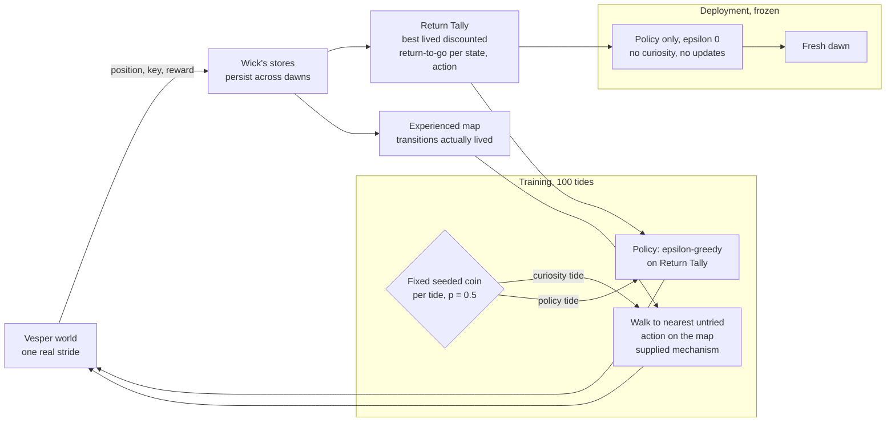
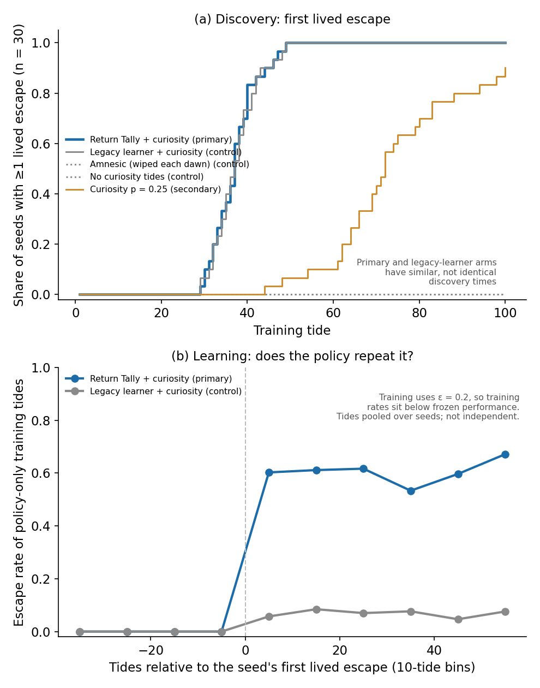

# Remnant: The Memory of No Escape

**Remnant is a time-loop reinforcement learning study.** A small agent, Wick, relives the
same tide on a tidal island. Every 54 strides the water takes the island and the world
resets to dawn: same start, key back on its hook, pearls back in the chapel. Only what
Wick has stored in memory carries over. The question is whether Wick can learn, from tides
it has actually lived, to escape the loop.

**Result:** yes, in this world. After 100 lived tides, Wick's frozen learned policy escaped
on every evaluation tide in **30 of 30 seeds** (Wilson 95% interval 0.89–1.00), always by
the shortest 42-stride route. Before training it escaped 0 times. Under the same exploration
mechanism, a legacy Q-learning agent succeeded in 1/30 seeds. An amnesic agent whose memory
was wiped at dawn and an agent with no curiosity tides both succeeded in 0/30.

**What was learned and what was supplied.** *Learned:* a Return Tally, a table of the best
discounted return Wick has actually lived from each state and action (model-free episodic
control). The frozen policy acts on it alone, with no planner, no curiosity and no updates.
*Supplied:* the way the escape is first found. On a fixed seeded schedule, half of the
training tides are "curiosity tides" in which Wick walks to the nearest unexplored edge of
its own map. Curiosity is not learned.


## Contents

- [The time-loop world](#the-time-loop-world)
- [How Wick learns](#how-wick-learns)
- [Results](#results)
- [Limits](#limits)
- [Quick start](#quick-start)
- [Evidence and reproduction](#evidence-and-reproduction)
- [Attribution and related work](#attribution-and-related-work)
- [Repository map](#repository-map)

## The time-loop world

The Reach of Vesper is a deterministic 72-node waypoint graph. Wick starts every tide at
Wrecksmoor Landing. Each stride costs −0.01. The Drowned Chapel holds pearls (+1, the
temptation). The Net Loft holds the Lamp-Key (+0.1), which opens the Harbor Lock. The
Tidegate beyond it is the escape (+10). The shortest escape takes 42 of the tide's 54
strides; taking the pearls first needs at least 62, so the pearls always cost that tide's
escape. Wick observes its position and whether it holds the key, and keeps its own marker
for whether it took pearls this tide. It never sees the clock. Full specification:
[docs/methods.md](docs/methods.md). Story setting: [docs/reach-story.md](docs/reach-story.md).

## How Wick learns



A tide's return ends at escape or at the toll; nothing is carried across the dawn, and
there is no simulated experience, replay of counterfactuals or model rollout.

## Results

Accepted study `return_tally_v1`: 5 arms × 30 seeds (7001–7030), 100 training tides each,
5 frozen evaluation tides per seed. Endpoint per seed: the frozen policy escapes on all 5.
The statistical unit is the seed; the 5 tides are repeated deployment checks in one
deterministic world, not independent samples.

| Arm | Seeds meeting endpoint | Wilson 95% |
|---|---|---|
| Return Tally + curiosity (primary) | 30/30 | 0.8865–1.0 |
| Legacy learner + same curiosity mechanism | 1/30 | 0.0059–0.1667 |
| Amnesic (stores wiped every dawn) | 0/30 | 0–0.1135 |
| No curiosity tides | 0/30 | 0–0.1135 |
| Secondary: curiosity p = 0.25 | 27/30 | 0.7438–0.9654 |

Pre-registered one-sided Fisher tests against each control: p ≤ 2.6 × 10⁻¹⁶. A post-hoc
paired sign test on the shared seeds gives 29 wins and 0 losses against the legacy
learner (p = 1.86 × 10⁻⁹), and 30 wins and 0 losses against each other control
(p = 9.31 × 10⁻¹⁰). Full account, discovery timing and the deployed route:
[docs/results.md](docs/results.md).



## Limits

- One fixed, deterministic world and start. This is not evidence of transfer, general
  navigation or superiority to modern RL methods.
- Discovery uses the supplied frontier walk on a fixed schedule; without curiosity tides
  no seed found the escape in 100 tides.
- The arms share the exploration mechanism and the curiosity coin, not identical training
  experience.
- Remaining tide time is not part of Wick's state, so there is no general guarantee that
  every remembered best return is reachable from every state; the measured dawn-start
  performance is what is supported.
- The explanation for the legacy learner's failure (dawn bootstrapping, Q(λ) on cycles) is
  a diagnosis, not a separately isolated cause.

## Quick start

Requires CPython 3.12 (tested on 3.12.15; the test suite also passes on 3.13). The study
code uses only the standard library; nothing needs installing.

```sh
python3 -m unittest discover -s tests                 # test suite
python3 experiments/run_return_tally_v1.py --smoke    # construction check, 2 tides
python3 experiments/run_return_tally_v1.py --gate     # verify the accepted results file
python3 experiments/run_metabucket_td_v1.py --gate    # verify an inherited result file
python3 tools/verify_release.py                       # check files against the release manifest
python3 tools/unpack_evidence.py --verify             # check the compressed historical data (no writes)
python3 tools/demo_frozen_policy.py                   # train one seed (about 1 s), deploy it frozen
```

The demo trains seed 7001 first (no trained state is shipped), then deploys the frozen
policy with curiosity disabled and the stores checked unchanged, and compares the route
with the accepted results. Figures need the optional plotting dependency:
`pip install -r requirements-plot.txt`, then `python3 analysis/figures_return_tally_v1.py`.

## Evidence and reproduction

- Accepted results: [`results/return_tally_v1.json`](results/return_tally_v1.json),
  SHA-256 `b3c6a3ac2bbd830ffd269e203e73e8e2a33ea4853e871a783d6850666345d9a9`.
- Pre-registration: [docs/preregistration_return_tally_v1.md](docs/preregistration_return_tally_v1.md).
- Experiment driver: [`experiments/run_return_tally_v1.py`](experiments/run_return_tally_v1.py).
- Paired analysis: [`analysis/paired_return_tally_v1.json`](analysis/paired_return_tally_v1.json).
- Machine-readable summary: [`study_summary.json`](study_summary.json).
- Reproduction guide (quick checks, demo, figures, the full 2-minute sweep in a separate
  directory): [docs/reproduce.md](docs/reproduce.md).
- Exploratory negatives: [docs/exploratory_negatives.md](docs/exploratory_negatives.md).
- Release changes and the inherited driver defect: [CHANGES.md](CHANGES.md).

## Attribution and related work

Remnant is an original project and controlled study, not a reproduction of a single paper
and not a new episodic-control algorithm. The Return Tally follows model-free episodic
control (Blundell et al., 2016, [arXiv:1606.04460](https://arxiv.org/abs/1606.04460)).
Curiosity tides relate to the remember-and-return principle of Go-Explore (Ecoffet et al.,
2021) but do not implement it, and they use no intrinsic reward, unlike Episodic Curiosity
through Reachability (Savinov et al., 2019). Details: [docs/related_work.md](docs/related_work.md).
Plotting uses Matplotlib (optional).

License: [MIT](LICENSE).

## Repository map

| Path | Contents |
|---|---|
| `remnant_core/` | World, agents, stores. Current study: `return_tally.py`, `episodic_runner.py`. |
| `experiments/` | Drivers. `run_return_tally_v1.py` (current; `--smoke`, `--gate`, `--run`); `run_metabucket_td_v1.py` (`--smoke`, `--gate`); `run_metabucket_v1.py` (`--smoke` only, no gate). |
| `results/` | Raw results: `return_tally_v1.json` (current); baseline and selector runs (historical). The two largest baseline files ship gzip-compressed (`records.json.gz`, `learners.json.gz`); unpack them only for legacy baseline analysis, see [docs/reproduce.md](docs/reproduce.md#compressed-historical-evidence). |
| `analysis/` | Derived analysis and figure scripts. |
| `figures/return_tally_v1/` | Current figures. Other `figures*/` folders are historical baseline figures. |
| `docs/` | Methods, results, pre-registration, related work, reproduction, history. |
| `tools/` | Release verifier, evidence unpacker, frozen-policy demo, disposable-copy reproduction. |
| `dev/` | Exploratory development code (not the accepted study). |
| `provenance/` | Data manifest for the compressed evidence; the stale historical manifest, kept as provenance. |
| `pilot_results/` | Historical baseline pilot data. |
