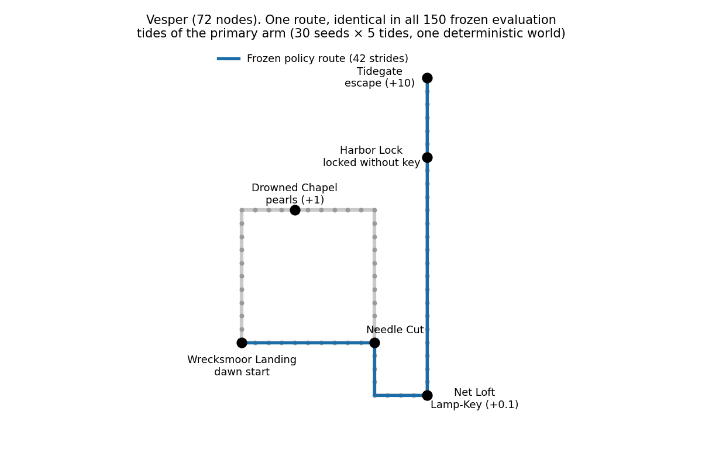

# Results: return_tally_v1

Accepted result file: [`results/return_tally_v1.json`](../results/return_tally_v1.json)
(SHA-256 `b3c6a3ac2bbd830ffd269e203e73e8e2a33ea4853e871a783d6850666345d9a9`).
Methods: [methods.md](methods.md). Pre-registration: [preregistration_return_tally_v1.md](preregistration_return_tally_v1.md).

## Headline

After 100 lived tides, Wick's frozen learned policy, with no planner, no curiosity and no
further learning, escaped on all 5 evaluation tides in **30 of 30 seeds** (Wilson 95%
interval 0.8865–1.0). That is 150 of 150 evaluation tides, every one in 42 strides (the
shortest route) with tide return 9.68. Before training the same procedure escaped in 0 of
150 evaluation tides. The 150 tides are 5 repeated checks of each of 30 learned policies
in one deterministic world; the statistical denominator is 30 seeds.

## Seed-level endpoint by arm (n = 30 seeds each, seeds 7001–7030)

| Arm | Endpoint (all 5 frozen tides escape) | Wilson 95% | Frozen eval tides escaped | Pre-training eval tides escaped |
|---|---|---|---|---|
| Return Tally + curiosity (primary, `ec_curious`) | 30/30 | 0.8865–1.0 | 150/150 | 0/150 |
| Legacy learner + curiosity (`q_curious`) | 1/30 (seed 7011) | 0.0059–0.1667 | 5/150 | 0/150 |
| Amnesic, wiped each dawn (`ec_amnesic`) | 0/30 | 0–0.1135 | 0/150 | 0/150 |
| No curiosity tides (`ec_only`) | 0/30 | 0–0.1135 | 0/150 | 0/150 |
| Secondary: curiosity p = 0.25 (`ec_curious_p25`) | 27/30 | 0.7438–0.9654 | 135/150 | 0/150 |

## Statistical tests

**Pre-registered analysis (the record, unchanged).** Unpaired one-sided Fisher exact test
on the seed-level endpoint, primary > control, threshold 0.01/3 per control:

| Control | p |
|---|---|
| `q_curious` | 2.62 × 10⁻¹⁶ |
| `ec_amnesic` | 8.46 × 10⁻¹⁸ |
| `ec_only` | 8.46 × 10⁻¹⁸ |

All five pre-registered criteria (P1–P5) were met.

**Post-hoc paired analysis (added at release, not pre-registered).** All arms use the same
30 seeds, so seeds can be paired. Exact one-sided sign test (exact McNemar) on discordant
pairs, computed from the rows by
[`analysis/paired_return_tally_v1.py`](../analysis/paired_return_tally_v1.py), output in
[`analysis/paired_return_tally_v1.json`](../analysis/paired_return_tally_v1.json):

| Control | Primary wins | Primary losses | Both succeed | Neither | p (one-sided) |
|---|---|---|---|---|---|
| `q_curious` | 29 | 0 | 1 | 0 | 1.862645149230957 × 10⁻⁹ |
| `ec_amnesic` | 30 | 0 | 0 | 0 | 9.313225746154785 × 10⁻¹⁰ |
| `ec_only` | 30 | 0 | 0 | 0 | 9.313225746154785 × 10⁻¹⁰ |

Both paired p-values are below the pre-specified Bonferroni threshold 0.01/3.

## Discovery versus learning

- **Discovery is supplied.** In every seed of the primary arm the first lived escape came
  on a curiosity tide (median tide 37, range 29–49). The legacy-learner arm, sharing the
  same coin and frontier walk, lived its first escape in the same tide range.
- **Repeating it is learned.** Policy-only training tides escaped 0 of 553 times before a
  seed's first lived escape and 1,057 of 1,738 times after it in the primary arm (ε = 0.2 in
  training). For the legacy learner the figures are 0 of 557 and 128 of 1,727. These tide
  counts are pooled across seeds and are not independent samples. Policy-only tides include
  curiosity tides that fell back to the policy for every stride once the map was exhausted.
- **Without persistence nothing is learned.** The amnesic arm never lived an escape and its
  map never held more than 44 tried place–action pairs. Without curiosity tides, no seed
  lived an escape (maps of 30–135 tried place–action pairs; the full map is 472).
- **Secondary arm.** With p = 0.25, 27 seeds lived an escape by tide 100 (median first
  escape 71, range 44–100) and all 27 met the endpoint; the 3 that failed (7003, 7006, 7009)
  never lived one. One seed's first escape came at tide 100, and its frozen policy still
  escaped on all 5 evaluation tides.

The deployed route was identical in all 150 primary-arm evaluation tides, and in all 135
escaping tides of the secondary arm: Wrecksmoor Landing → Needle Cut → Net Loft (Lamp-Key)
→ Harbor Lock → Tidegate, skipping the pearls.

## Development and confirmation

- Development used seeds 9001–9003 only. An earlier exploratory design (model-free optimism
  for the Q-learner) failed there and was abandoned; see
  [exploratory_negatives.md](exploratory_negatives.md). The Return Tally design was then
  checked once per arm on those dev seeds, with no parameter changed afterwards.
- The pre-registration was then written and hashed. Only after that were the confirmatory
  seeds 7001–7030 run, once (the driver refuses to overwrite a result file).
- The order of these steps is recorded in the maintainers' private session chronology,
  which is not part of this release. Matching file hashes show the files are consistent;
  they are not an independent timestamp proof.
- An independent verification pass (reported by the project owner) reproduced all 150 arm-seed runs byte-for-byte and replayed all
  150 primary evaluation paths legally against the world's transition function.

## What this does not establish

- Transfer to other worlds or starts, general navigation, or superiority to modern RL methods.
- Learned exploration: the curiosity mechanism and its schedule are supplied.
- A general guarantee that remembered maximum returns are attainable from every compressed
  state; remaining tide time is not in the state. Only the measured dawn-policy performance
  is supported.
- Separately isolated causes for the legacy learner's failure.

## Historical results

The 30-seed baseline (`baseline_hidden_pearl_v1`, seeds 101–130: 0/30 escapes), the Route B
diagnostic, and the learned mode-selector runs (`metabucket_v1`, `metabucket_td_v1`) are
earlier, separate studies with different agents and seeds. They are not matched arms of
this study. See [history/](history/README.md).
